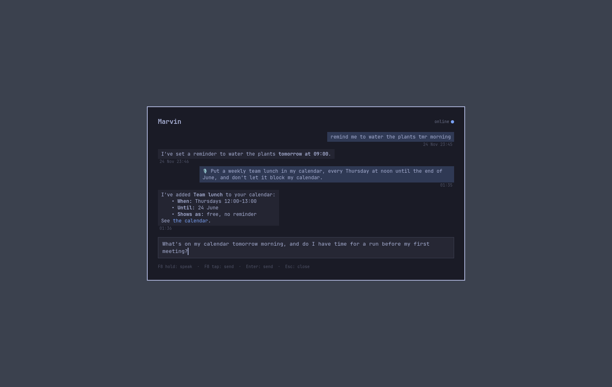

# clawchat

Hold a key, talk to your OpenClaw agent, let go. A small chat window for the [Omarchy](https://omarchy.org) desktop that opens in the middle of the screen, with the last few messages of your conversation, voice input through [Voxtype](https://voxtype.io), and the reply streaming in as it is written.



It talks to the OpenClaw gateway directly, over one connection that stays open, so the window appears at once and nothing has to launch. By default it joins the session of your Telegram chat with the agent, so the agent has the same context and the window shows that chat's history.

## Keys

The key is F8 unless you pick another.

| When | Do | Result |
|---|---|---|
| Window hidden | Hold the key | Window opens and recording starts. Let go: the transcript lands in the input box |
| Window hidden | Tap the key | Window opens, for reading or typing |
| Window open | Hold the key | Records more and appends it to the draft |
| Window open | Tap the key | Sends the draft, or closes the window when the draft is empty |
| Window open | Enter / Shift+Enter | Send / new line |
| Window open | Esc, or a click outside | Close (a draft is kept for next time) |
| Window open | PageUp / PageDown | Scroll the history |

A tap while the transcript is still being made sends it as soon as it arrives.

## Requirements

- Omarchy with the Quickshell-based shell (`omarchy-shell`) and Hyprland's Lua config
- An OpenClaw gateway you can reach from this machine, for example over Tailscale (`openclaw config set gateway.tailscale.mode serve`), and its gateway token for the one-time pairing
- Node.js 22.19 or newer, and npm
- Voxtype for voice (`omarchy install dictation`). Without it you can still type

## Install

```bash
git clone https://github.com/Tedodor423/clawchat ~/.config/omarchy/plugins/theo.clawchat
~/.config/omarchy/plugins/theo.clawchat/install.sh
```

The script asks for the gateway URL and the agent's name, pairs this device, enables the plugin and binds F8 in `~/.config/hypr/bindings.lua` (a backup is made first). `--key F7` picks another key, `--no-bind` leaves your bindings alone.

Pairing registers this machine as its own device with only the `operator.read` and `operator.write` scopes. The gateway token is used once and is not stored; afterwards the device token in `~/.local/state/omarchy/theo.clawchat/openclaw/` (mode 600) is used. If your gateway wants new devices approved, approve it there and run the script again.

## Settings

`~/.local/state/omarchy/theo.clawchat/config.json`. Every key is optional. Restart the shell (`omarchy restart shell`) after changing it.

| Key | Default | Meaning |
|---|---|---|
| `gatewayUrl` | | `wss://...` address of the gateway. `$OPENCLAW_GATEWAY_URL` also works |
| `envFile` | | A `KEY=value` file to read `OPENCLAW_GATEWAY_URL` (and, for pairing, `OPENCLAW_GATEWAY_TOKEN`) from |
| `agentName` | `OpenClaw` | Title of the window |
| `agentId` | `main` | Which agent to talk to |
| `channel` | `telegram` | Join the most recent direct session of this channel (`whatsapp`, ...). Empty: the agent's main session |
| `sessionKey` | | Name the session outright, for example `agent:main:main` |
| `deliver` | `false` | Also post the agent's replies into that channel's chat |
| `historyLimit` | `30` | Messages shown |
| `keyLabel` | `F8` | Key name shown in the hints |

With `deliver` off, what you send from the window and the replies to it stay out of the Telegram (or other) chat itself, though the agent remembers them there.

## Commands

```bash
omarchy-shell theo.clawchat toggle     # open or close
omarchy-shell theo.clawchat status     # connection, voice state, counts
omarchy-shell theo.clawchat press      # what the key binding calls
omarchy-shell theo.clawchat release
node bridge/clawchat-bridge.mjs whoami # device id, paired or not
node bridge/clawchat-bridge.mjs pair   # pair by hand (OPENCLAW_GATEWAY_TOKEN=...)
```

## How it works

- `Service.qml` holds the state and the key logic, and runs `bridge/clawchat-bridge.mjs`: a Node process with one `@openclaw/gateway-client` connection, speaking JSON lines on stdin/stdout (`chat.history`, `chat.send`, the `chat` event stream).
- `bridge/voice` runs `voxtype record start --file=... --no-osd`, so the transcript goes to a file the service reads instead of being typed into whatever has focus.
- `Overlay.qml` and `ChatCard.qml` draw the window in the current Omarchy theme.
- `dev/harness.sh` renders the card offscreen in each state, into `$XDG_RUNTIME_DIR/theo-clawchat-dev/shots`.

## Limits

- Text only: attachments and tool activity in the history are not shown.
- The binding takes the key away from applications (plain F8 no longer reaches them).
- A plugin change needs `omarchy restart shell` to load.

## Uninstall

```bash
omarchy plugin disable theo.clawchat
rm -rf ~/.config/omarchy/plugins/theo.clawchat ~/.local/share/theo.clawchat ~/.local/state/omarchy/theo.clawchat
```

Then delete the `-- BEGIN clawchat` block from `~/.config/hypr/bindings.lua` and remove the device on the gateway.

MIT licence.
